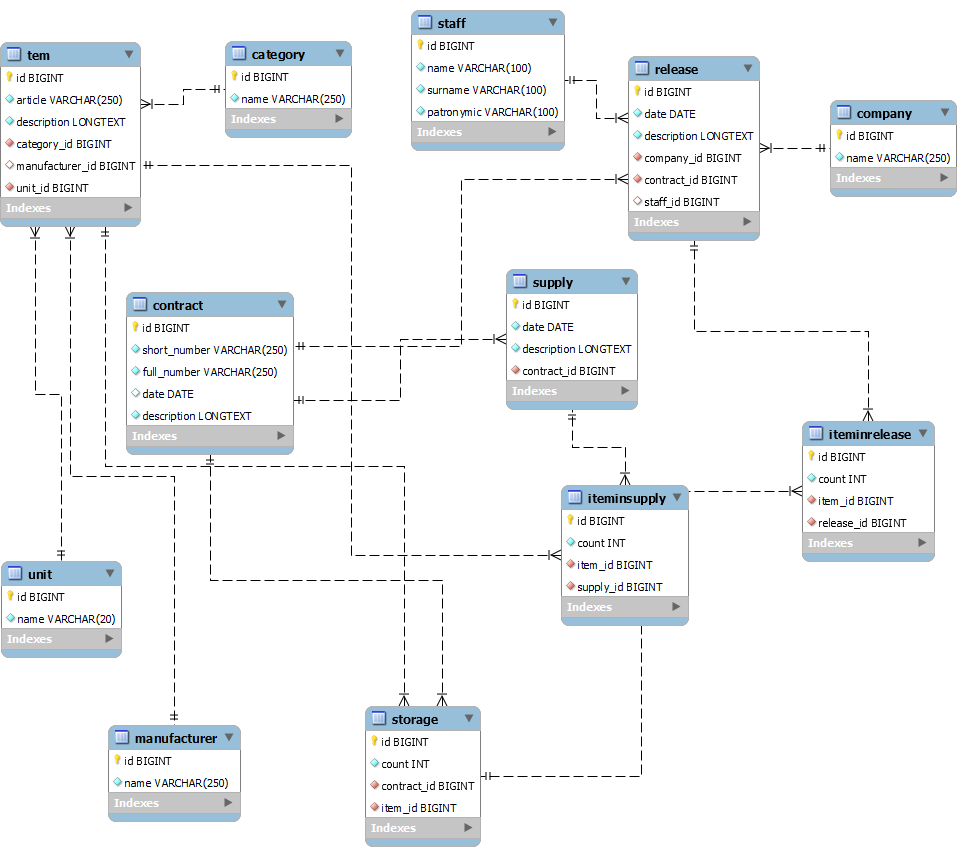

## Что такое WMSapp?
*WMSapp* - это простое приложение, которое помогает мне вести складской учёт на работе.
***
Логика работы очень проста:  
На склад поступает оборудование и материалы, для последуещей передачи монтажной организации. Всё поступает и выдаётся под определённый договор.
***
Для хранения данных используется реляционная БД со следующей структурой:  
  
**Словари:**
- *category* - категория к которой относится позиция (товар), например крепёж, трубы и т.д.
- *manufacturer* - производитель позиции (товара)
- *unit* - единица измерения (шт, метров и т.д.)
- *item* - полное наименование позиции (товара) включающее производителя, артикул, описание, ед. изм. и категорию
- *staff* - сотрудник которому выдётся товар
- *company* - фирма которой выдаётся товар
- *contract* - договор по которому производятся работы

***storage*** - таблица в которой хранится текущее состояние склада, какие позиции, сколько и по каким договорам  
***supply*** - информация о поступлении товара на склад (дата, транспортная компания, договор)  
***iteminsupply*** - позиции которые находятся в определённой поставке  
***release*** - информация о выдаче (дата, сотрудник/фирма, договор)  
***iteminrelease*** - позиции который находятся в определённой выдаче
***
Используемый стек: **Django**, **Bootstrap**, **MySQL**.  
Стек выбран с учётом возможностей бесплатного аккаунта *www.pythonanywhere.com*.

## Мобильный интерфейс

При открытии приложения интерфейс автоматически выбирается по `User-Agent`:
телефоны и планшеты (Android, iPhone, iPad и другие мобильные агенты) переходят
в мобильную версию, компьютеры — в полную. Пустой или неизвестный агент считается
десктопным. Если браузер маскируется под компьютер, по одному `User-Agent` отличить
его от компьютера невозможно.

Мобильные страницы находятся по адресу `/mobile/`; этот явный адрес доступен на
любом устройстве. Обычные ссылки на склад, документы, справочники и отчёты на
мобильном устройстве переводятся на соответствующие мобильные страницы.
Перенаправляются только GET/HEAD-запросы, отправка форм и AJAX не изменяются.

Пункты «Мобильная версия» и «Полная версия» позволяют выбрать интерфейс вручную;
выбор сохраняется в сессии. Пункт «Автовыбор интерфейса» снова включает определение
по браузеру. Эти переключатели доступны также на экране входа. Новые настройки
middleware и дополнительные зависимости не требуются.

- Общие остатки и остатки по договорам: карточки, поиск, фильтры, пагинация.
- Поставки и выдачи: создание, редактирование, состав документа, добавление и
  удаление позиций с пересчётом остатков через существующие складские сервисы.
- Все семь справочников: поиск, добавление, редактирование и удаление записей.
- Отчёты по складу и движению по договору с загрузкой Excel.
- Отдельный вход, общая с полной версией сессия и выход через POST.

Интерфейс использует существующую БД; изменения моделей и миграции не нужны.
Мобильные шаблоны и стили расположены в `storage/templates/mobile/` и
`storage/static/mobile/`, обработчики — в `storage/mobile/`. Bootstrap, jQuery и
внешние CDN для мобильной версии не нужны. Основные действия работают без
JavaScript; скрипт добавляет поиск в списке позиций и защиту от повторного нажатия.

Доступ контролируют стандартные разрешения Django `view_*`, `add_*`, `change_*`
и `delete_*`. Для просмотра состава документа нужны права на документ и его
позиции (`view_iteminsupply` / `view_iteminrelease`). Непустой документ нельзя
удалить или перенести на другой договор до удаления его позиций. В выдаче можно
выбрать остаток другого договора, как и в полной версии; договор хранения указан
в списке и карточке позиции.

Для существующего развёртывания достаточно обновить код и собрать статику обычной
командой `python manage.py collectstatic`. Рабочие настройки `wms/settings.py`
остаются локальными.

### Проверка без рабочей базы

Команды для PowerShell из корня репозитория:

```powershell
python -m venv myvenv
.\myvenv\Scripts\python.exe -m pip install -r requirements-dev.txt
.\myvenv\Scripts\python.exe manage.py test storage --settings=wms.test_settings
.\myvenv\Scripts\python.exe tools/preview_mobile.py
```

Предпросмотр: [http://127.0.0.1:8001/mobile/](http://127.0.0.1:8001/mobile/).
Демонстрационный вход: `demo` / `mobile-preview`.
Скрипт создаёт отдельную временную SQLite-базу с примерами и слушает только
`127.0.0.1`; рабочая БД не используется. Для остановки нажмите Ctrl+C.
`wms.test_settings` предназначен только для тестов и локального предпросмотра,
не для рабочего сервера.
